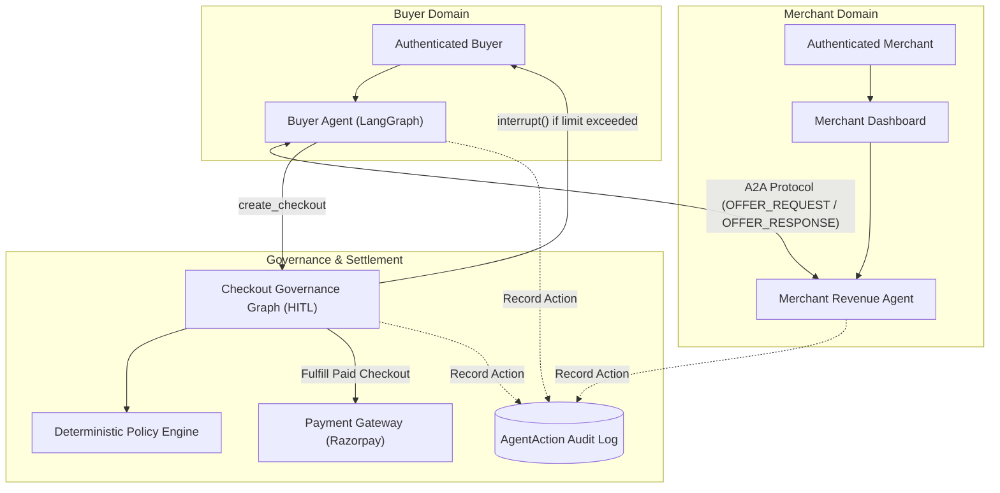
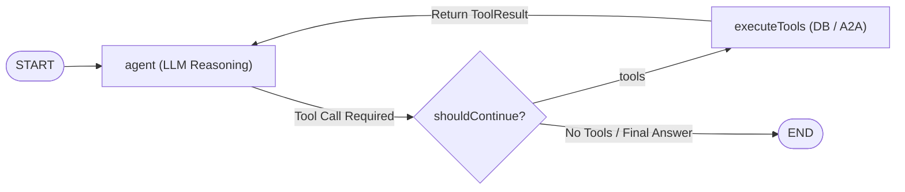
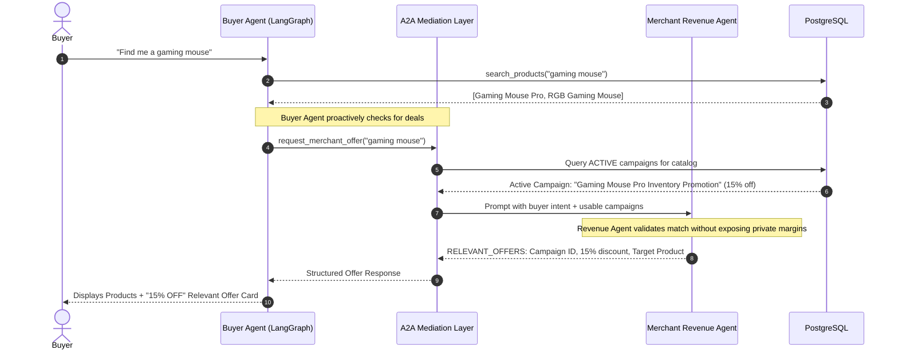
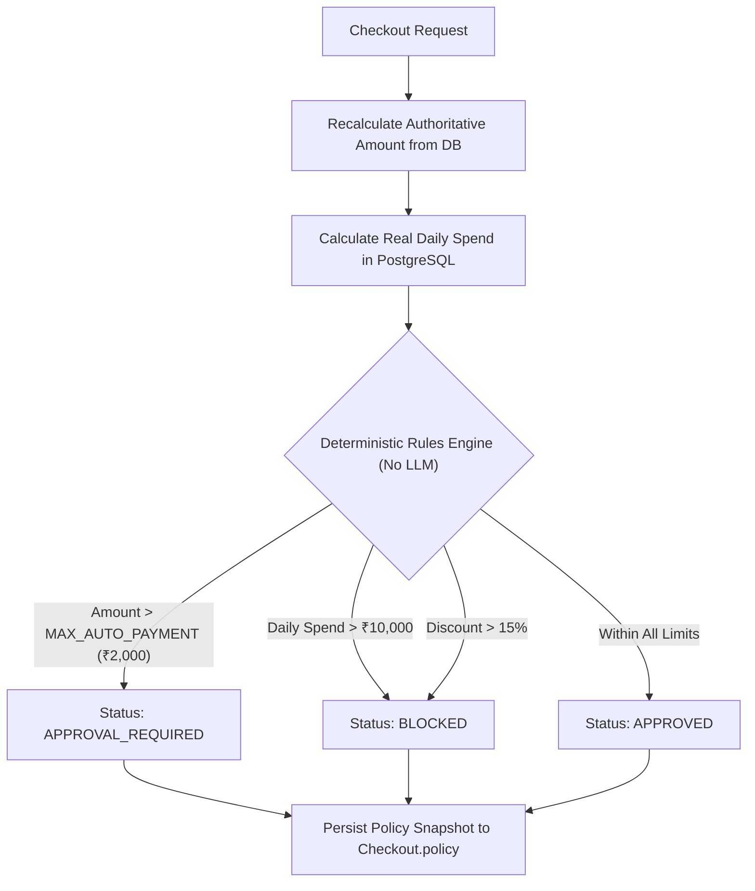
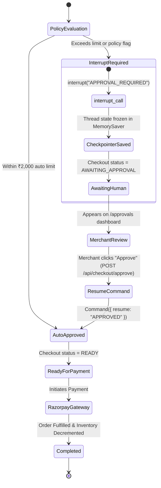
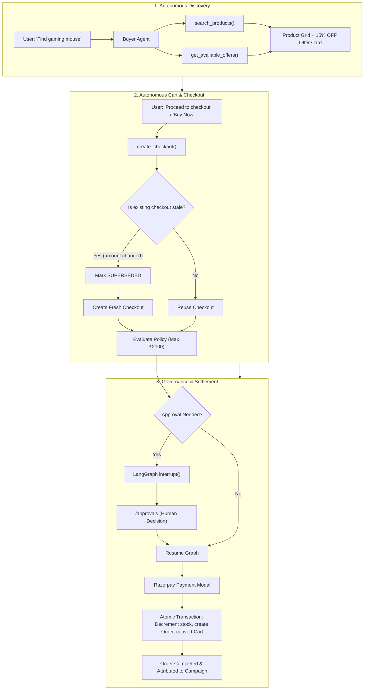

# Agentic AI Architecture & Multi-Agent Communication Guide

This document provides a comprehensive technical breakdown of all **Agentic AI** design patterns, state machines, and protocols implemented in **AgentPay**.

---

## 1. What Makes This System "Agentic"?

Traditional AI in e-commerce is typically **passive or generative** (e.g., product recommendation search or chat bots that only return plain text).

**AgentPay** is an **active, autonomous multi-agent system (MAS)**:
- **Autonomy**: Agents take concrete actions in the database (querying catalogs, modifying carts, generating checkout authorizations, creating campaign proposals).
- **Goal-Directed Tool Use**: The models do not just generate text; they formulate plans and call structured backend tools with Zod validation.
- **Agent-to-Agent (A2A) Interaction**: AI agents representing different stakeholders (Buyer vs. Merchant) communicate, negotiate, and share data using structured protocols.
- **Neuro-Symbolic Governance**: The LLM handles unstructured intent and reasoning (neuro), while strict deterministic TypeScript code governs money, spending limits, and payment security (symbolic).
- **Human-In-The-Loop (HITL)**: High-risk or policy-exceeding transactions automatically pause execution threads and require human approval before financial execution.

---

## 2. Multi-Agent Taxonomy

### 1. Buyer Agent ([`buyerAgent.js`](file:///Users/sagilinithin/Downloads/agentpay-campaigns/src/lib/agents/buyerAgent.js))
- **Role**: Personal shopping assistant for the authenticated consumer.
- **Bound Scope**: Scoped strictly to `session.user.id`.
- **Tools**:
  - `search_products`: Semantic & filter search across PostgreSQL product catalog.
  - `get_product` / `check_inventory`: Real-time stock verification.
  - `create_cart`: Autonomous cart creation and item addition.
  - `get_available_offers`: Direct query for active discount campaigns.
  - `request_merchant_offer`: Initiates A2A communication with merchant agents.
  - `create_checkout`: Generates authoritative checkout sessions.

### 2. Merchant Revenue Agent ([`revenueAgent.js`](file:///Users/sagilinithin/Downloads/agentpay-campaigns/src/lib/agents/revenueAgent.js))
- **Role**: AI business analyst and campaign strategist for the merchant.
- **Bound Scope**: Scoped strictly to `merchant.id`.
- **Tools**:
  - `find_cross_sell_opportunities`: Analyzes co-purchase baskets and attachment rates.
  - `find_upsell_opportunities`: Identifies higher-tier alternatives in identical categories.
  - `find_abandoned_cart_opportunities`: Calculates recoverable cart revenue.
  - `find_inventory_opportunities`: Detects stagnant capital in overstocked items.
  - `create_campaign_proposal`: Generates draft promotional campaigns with auto-budgeting.

### 3. Payment & Governance Agent ([`checkoutGraph.js`](file:///Users/sagilinithin/Downloads/agentpay-campaigns/src/lib/graphs/checkoutGraph.js))
- **Role**: Financial risk gatekeeper and human-in-the-loop state machine.
- **Bound Scope**: Checkout-level transaction states.
- **Responsibilities**:
  - Re-evaluates authoritative PostgreSQL amounts.
  - Enforces deterministic spending caps.
  - Suspends execution threads (`interrupt`) when approvals are needed.
  - Links payments to orders idempotently.

---

## 3. Core Agentic AI Concepts Implemented

### A. LangGraph ReAct Cycle & Tool Execution
Both the Buyer Agent and Checkout Flow use **LangGraph** (`StateGraph`):

- **Cycles**: If a buyer asks to *"Find a gaming mouse and add it to my cart"*, the agent first runs `search_products`, processes the output, and in the next cycle automatically invokes `create_cart`.
- **Dynamic Tool Injection**: Tools are instantiated dynamically inside user request scope (`createCartTool(userId)`), guaranteeing that the LLM cannot manipulate identity.

---

## B. Agent-to-Agent (A2A) Communication Protocol
Implemented in [`agentToAgent.js`](file:///Users/sagilinithin/Downloads/agentpay-campaigns/src/lib/agents/agentToAgent.js).

> [!IMPORTANT]
> **Data Privacy in A2A**: The Buyer Agent is never allowed to inspect private merchant analytics (margins, historical order counts, unapproved campaigns). The Revenue Agent filters and exposes only public campaign terms.

---

### C. Neuro-Symbolic Governance & Policy Engine
Implemented in [`policyEngine.js`](file:///Users/sagilinithin/Downloads/agentpay-campaigns/src/lib/policy/policyEngine.js).

- **Why Neuro-Symbolic?**: LLMs are probabilistic; they cannot be allowed to make unchecked financial decisions. The symbolic policy engine provides 100% predictable, mathematical guarantees.
- **Policy Snapshotting**: The calculated policy decision is stored as an immutable JSON snapshot on the `Checkout` model, ensuring the decision cannot drift.

---

### D. Human-in-the-Loop (HITL) via LangGraph Interrupts
Implemented in [`checkoutGraph.js`](file:///Users/sagilinithin/Downloads/agentpay-campaigns/src/lib/graphs/checkoutGraph.js).

- **State Checkpointing**: LangGraph freezes the thread state using `MemorySaver` when `interrupt()` is called.
- **Resumption**: The thread remains idle until an authenticated merchant posts an explicit approval command, resuming execution at the exact state.

---

### E. Full Auditability (`AgentAction`)
Implemented in [`auditLog.js`](file:///Users/sagilinithin/Downloads/agentpay-campaigns/src/lib/audit/auditLog.js).

Every autonomous step across all agents writes an immutable record:

| Field | Description | Example |
| :--- | :--- | :--- |
| `agentType` | Which agent acted | `BUYER_AGENT`, `MERCHANT_AGENT`, `PAYMENT_AGENT` |
| `action` | Operational verb | `SEARCH_PRODUCTS`, `CHECKOUT_SUPERSEDED`, `ORDER_CREATED` |
| `entityType` | Target model | `Product`, `Cart`, `Checkout`, `Order`, `Campaign` |
| `input` | Exact parameters sent to tool | `{ userId: "...", amount: 4500 }` |
| `output` | Exact result returned | `{ checkoutId: "cm...", status: "READY" }` |
| `status` | Execution status | `SUCCESS`, `BLOCKED`, `FAILED` |
| `reason` | Human-readable audit explanation | *"Transaction approved: within ₹2000 auto-payment limit"* |

---

## 4. End-to-End Buyer Lifecycle

---

## 5. Summary of Technologies

- **LangChain Core (`@langchain/core`)**: Tools, schemas, messages (`AIMessage`, `ToolMessage`).
- **LangGraph (`@langchain/langgraph`)**: Stateful cyclical graphs, state schemas, conditional edges, interrupts, and checkpointers.
- **Google GenAI / Gemini (`@langchain/google-genai`)**: Cognitive reasoning and intent parsing.
- **Prisma & PostgreSQL**: Authoritative state, atomic transactions, row locking, and relational campaign attribution.
- **Zod**: Type-safe input validation on all agent tools.
