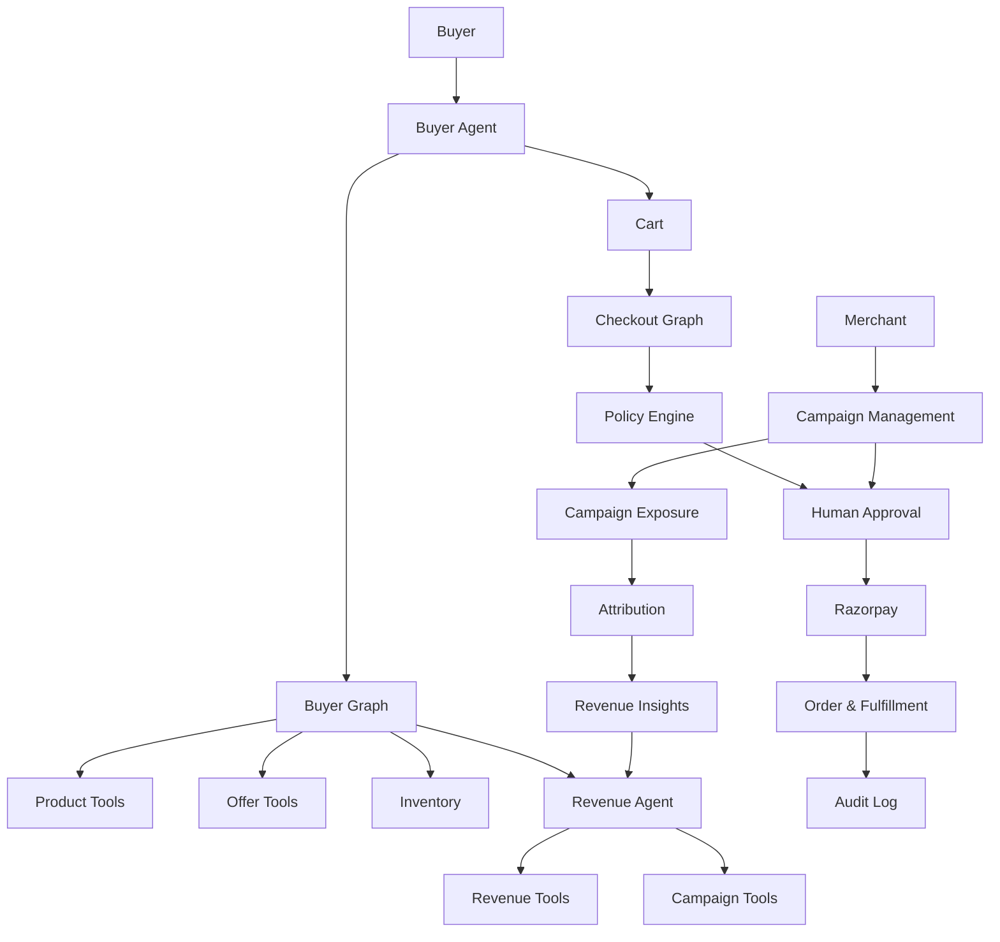
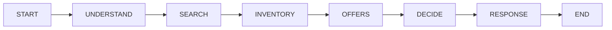
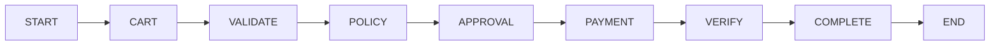
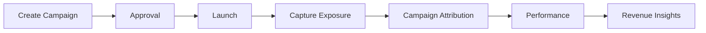
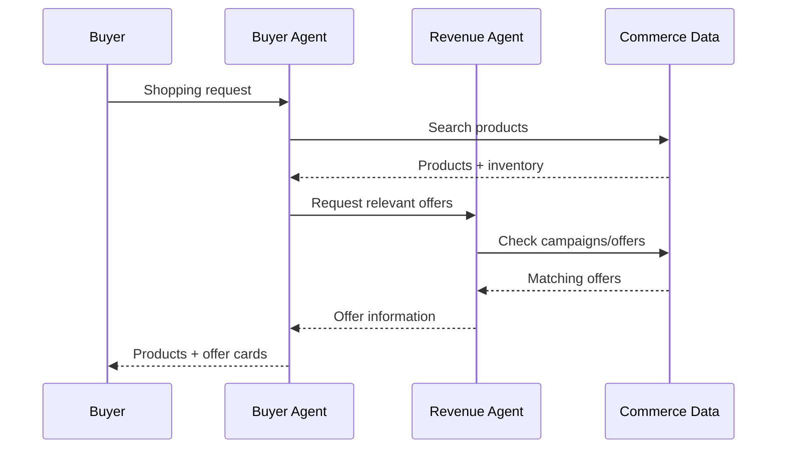

# AgentPay

AgentPay is an agentic commerce platform where specialized AI agents coordinate across buyer and merchant workflows to automate shopping, offers, campaigns, checkout, and commerce operations.

## Core Agentic Architecture



## Agents

### Buyer Agent

The Buyer Agent is the primary conversational agent. It:

- Understands natural-language shopping requests.
- Searches the live product catalog.
- Checks product inventory.
- Retrieves relevant merchant offers.
- Uses tools to interact with commerce data.
- Coordinates with the Revenue Agent for merchant-side information.
- Presents products and offers as actionable cards.
- Adds selected products to the cart after explicit user selection.

### Revenue Agent

The Revenue Agent handles merchant-side intelligence around:

- Campaigns
- Offers
- Campaign targeting
- Campaign exposure
- Attribution
- Revenue data
- Revenue insights

This enables **agent-to-agent coordination** between buyer-side and merchant-side intelligence.

## Graph-Based Workflows

Agent behavior is implemented through explicit graph workflows instead of a single unrestricted LLM call.

### Buyer Graph



**Request → Product Search → Inventory → Offers → Decision → Response**

### Checkout Graph



Checkout is separated from conversational shopping so purchase execution remains controlled and validated.

## Merchant Workflow



The merchant workflow connects campaign creation with exposure tracking, attribution, performance, and revenue insights.

## Agent-to-Agent Flow



The agents coordinate through **structured messages, tools, and workflows**, rather than independently generating responses.

## Tool Layer

The project separates agent reasoning from business actions through dedicated tools:

| Tool | Responsibility |
|---|---|
| `productTools` | Product search and catalog operations |
| `offerTools` | Offer retrieval |
| `revenueTools` | Revenue and merchant intelligence |
| `campaignTools` | Campaign operations |
| `cartTools` | Cart operations |
| `checkoutTools` | Checkout actions |

## Safety & Control

- **Policy Engine** — validates spending and checkout decisions.
- **Human Approval** — sensitive actions can require explicit approval.
- **Audit Log** — records important agent actions and commerce events.
- **Payment Verification** — validates payment state before completion.
- **Idempotency** — helps prevent duplicate payment/order operations.

## End-to-End Commerce Flow

```text
User Request
    ↓
Buyer Agent
    ↓
Buyer Graph
    ├── Product Search
    ├── Inventory Check
    └── Offer Retrieval
            ↓
       Revenue Agent
            ↓
     Relevant Offers
            ↓
       User Selection
            ↓
           Cart
            ↓
     Checkout Graph
            ↓
      Policy / Approval
            ↓
        Razorpay
            ↓
     Order Fulfillment
            ↓
        Audit Trail
```

## Tech Stack

- **Next.js / React** — application and UI
- **JavaScript** — application logic
- **Graph-based agent orchestration** — workflow execution
- **Prisma** — database access
- **Razorpay** — payment processing
- **NextAuth/Auth.js** — authentication
- **Tailwind CSS** — UI styling

## Project Structure

```text
src/
├── app/
│   ├── buyer/
│   ├── merchant/
│   ├── cart/
│   ├── checkout/
│   ├── approvals/
│   └── api/
├── components/
└── lib/
    ├── agents/
    │   ├── buyerAgent.js
    │   └── revenueAgent.js
    ├── graphs/
    │   ├── buyerGraph.js
    │   └── checkoutGraph.js
    ├── tools/
    ├── policy/
    ├── audit/
    ├── merchant/
    ├── payments/
    └── db/
```

## Key Differentiator

> **Agents reason → graphs control execution → tools perform actions → policies guard sensitive operations → audit logs provide traceability.**

AgentPay is therefore built as an **agentic commerce system**, where buyer and merchant intelligence can collaborate while important actions remain structured, controlled, and observable.
